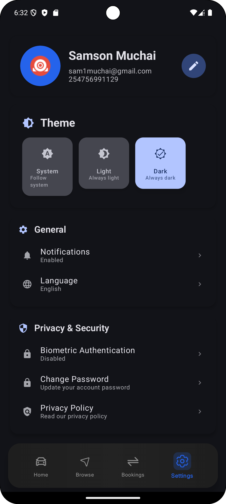
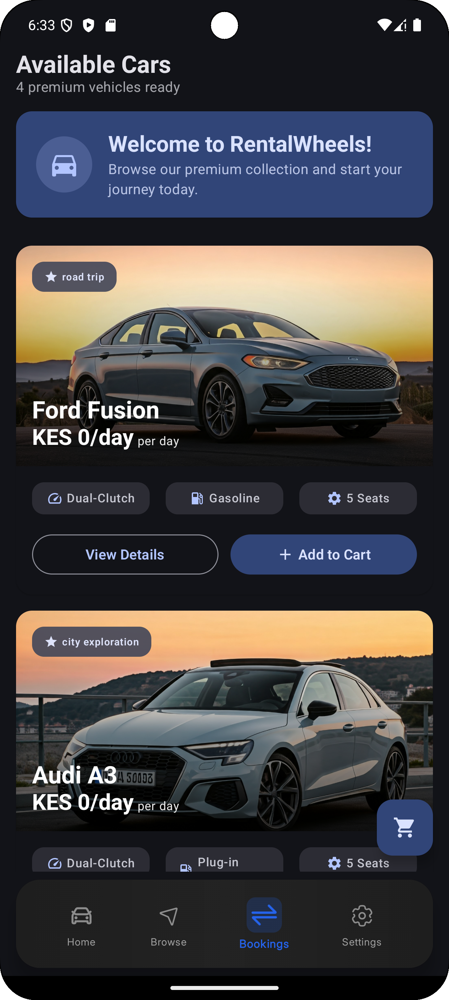
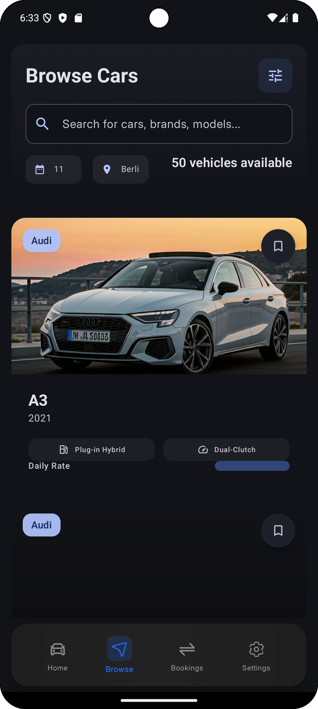
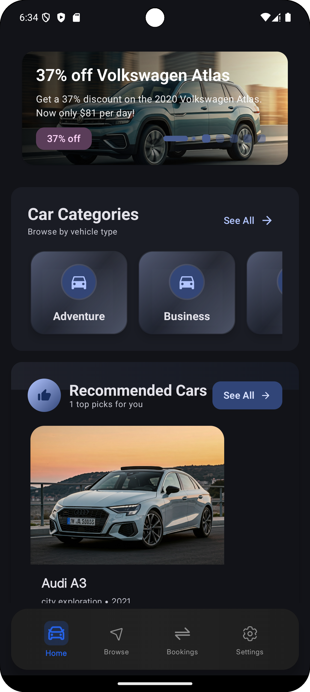
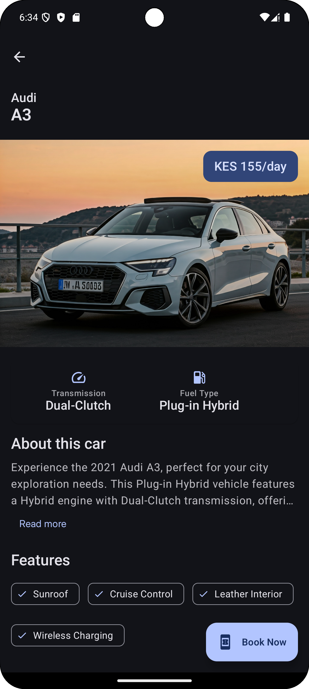
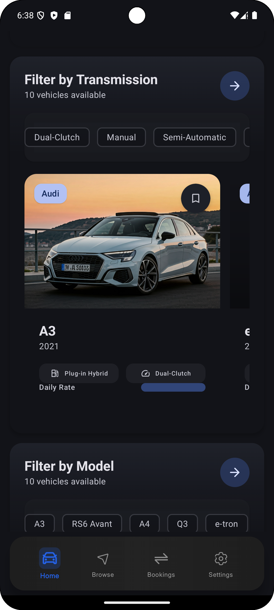

# RentalWheels


A modern Android car rental simulation app built with Jetpack Compose and Firebase. This is a portfolio project demonstrating clean architecture, reactive programming, and modern Android development practices.

> **Note**: This is a demonstration app. Booking functionality is simulated and no real transactions occur.

## Screenshots

<table>
  <tr>
    <td></td>
    <td></td>
    <td></td>
  </tr>
  <tr>
    <td></td>
    <td></td>
    <td></td>
  </tr>
</table>

## Features

- Browse cars with filtering (brand, year, fuel type, transmission, price)
- Simulated booking flow with cart functionality
- User authentication via Firebase
- Theme customization (Light/Dark/System)
- Real-time data synchronization with Firestore
- Booking history and analytics

## Tech Stack

### Core
- **Kotlin** - Primary language
- **Jetpack Compose** - Declarative UI framework
- **Material Design 3** - UI components and theming
- **Coroutines & Flow** - Asynchronous programming

### Architecture
- **MVVM** - Separation of concerns with ViewModels
- **Repository Pattern** - Data layer abstraction
- **Hilt** - Dependency injection
- **Navigation Compose** - Type-safe navigation

### Firebase
- **Firestore** - NoSQL database for car data
- **Authentication** - Email/password authentication
- **Storage** - Car images

### Libraries
- **Coil** - Image loading
- **Accompanist** - System UI controller
- **Material Icons Extended** - Icon library

## Architecture

The app follows MVVM architecture with clear separation of concerns:

```
┌─────────────────────────────────────┐
│         UI Layer (Compose)          │
│  Screens + Reusable Components      │
└──────────────┬──────────────────────┘
               │
┌──────────────▼──────────────────────┐
│         ViewModel Layer             │
│  State Management + Business Logic  │
└──────────────┬──────────────────────┘
               │
┌──────────────▼──────────────────────┐
│        Repository Layer             │
│    Data Access Abstraction          │
└──────────────┬──────────────────────┘
               │
┌──────────────▼──────────────────────┐
│         Firebase Backend            │
│  Firestore + Auth + Storage         │
└─────────────────────────────────────┘
```

### Key Components

**ViewModels**
- `CarViewModel` - Manages car catalog and home screen state
- `BookingsViewModel` - Handles booking operations and cart state
- `BrowseViewModel` - Controls filtering and search
- `AnalyticsViewModel` - Processes booking statistics

**Repositories**
- `CarRepository` - Fetches and caches car data from Firestore
- `BookingRepository` - Manages booking lifecycle

**Design System**
- Custom spacing scale (4dp to 64dp)
- Material 3 color system with theme support
- Consistent elevation and typography

### Data Flow

1. User interacts with Composable UI
2. ViewModel processes business logic
3. Repository fetches/updates data from Firebase
4. StateFlow emits new state
5. UI recomposes with updated data

## Setup

### Prerequisites
- Android Studio Hedgehog or later
- JDK 17+
- Android SDK (minSdk 24, targetSdk 34)

### Installation

1. Clone the repository
```bash
git clone https://github.com/muchaisam/Rentalwheels.git
```

2. Add `google-services.json` to `app/` directory

3. Build and run
```bash
./gradlew assembleDebug
```

### Firebase Configuration

Create a Firebase project and enable:
- Authentication (Email/Password)
- Firestore Database
- Storage

The app expects the following Firestore structure:
```
cars/
  {carId}/
    - name: String
    - brand: String
    - model: String
    - year: Int
    - dailyRate: Int
    - imageUrl: String
    - category: String
    - transmission: String
    - fuelType: String
    - seats: Int
    - features: List<String>
```

## Project Structure

```
app/src/main/java/com/msdc/rentalwheels/
├── data/
│   ├── model/              # Data classes
│   └── repository/         # Data access layer
├── ui/
│   ├── components/         # Reusable composables
│   ├── screens/            # Screen-level composables
│   └── theme/              # Design system & theming
├── viewmodel/              # ViewModels
└── utils/                  # Utility classes
```

## Implementation Highlights

**Reactive Theme System**
- Theme changes update system UI instantly without restart
- SharedPreferences listener triggers recomposition
- Supports Light, Dark, and System themes

**Efficient Image Loading**
- Coil handles async loading with memory/disk caching
- Crossfade animations for smooth transitions

**State Management**
- StateFlow for reactive UI updates
- ViewModel survives configuration changes
- Clean separation between business logic and UI

**Firebase Integration**
- Real-time data sync with Firestore
- Optimistic UI updates with local caching
- Proper error handling and loading states

## License

MIT License - see [LICENSE](LICENSE) for details

## Contact

**Samson Muchai**
- Email: sam1muchai@gmail.com
- GitHub: [@muchaisam](https://github.com/muchaisam)
- Twitter: [@smuchai10](https://twitter.com/smuchai10)